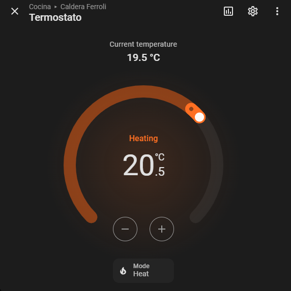
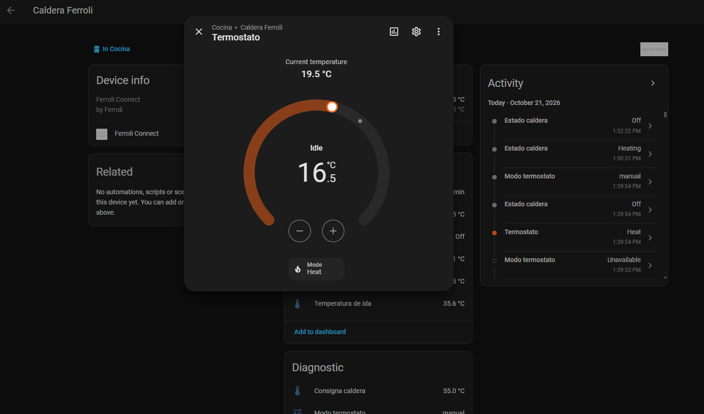

# Ferroli Connect for Home Assistant

Native Home Assistant integration for any **Ferroli** boiler paired with the
**Ferroli Connect** Wi‑Fi receiver (a white‑label **Topband / MXCHIP** device).
The integration talks to the **Ferroli Connect** receiver, not to a specific
boiler model, so it should work with **any boiler that uses Ferroli Connect**
(it was developed and tested on a Bluehelix, but the protocol is the receiver's,
not the boiler's). It reads the receiver's MQTT traffic, decodes the binary
protocol, exposes native entities (thermostat + sensors) and can keep the
official app working by bridging the device to the Topband cloud.

> Reverse‑engineered and reversible. It only talks to **your** device on **your**
> network. No cloud account is required for Home Assistant to work.

## What you get

- **Thermostat** (`climate`): room temperature, setpoint and setpoint control.
- **Sensors**: flow temperature, DHW (hot water) temperature, DHW flow,
  boiler state (Off / Heating / Hot water), plus diagnostic values.
- **Optional cloud bridge**: the integration relays the device ↔ Topband so the
  official Ferroli app keeps working.

## Screenshots

| Thermostat (heating) | Device page |
|---|---|
|  |  |

The thermostat card shows **Heating** when the setpoint is above the room
temperature (or the boiler is actively firing) and **Idle** otherwise, so you
can tell at a glance whether it's heating. Entity names follow your Home
Assistant language (English / Spanish provided).

## How it works

The receiver connects to `eu-mqtt.topband-cloud.com:1883` (plain MQTT). You
**redirect that name to your Home Assistant** so the device connects to your own
MQTT broker; this integration then reads/decodes it and (optionally) bridges the
traffic back to the real cloud.

```
Receiver ──(DNS redirect)──▶ your MQTT broker ──▶ Ferroli Connect integration ──▶ entities
                                   ▲                         │
                                   └────────── bridge ───────┴──▶ Topband cloud (official app)
```

## Prerequisites (one‑time network setup)

1. **MQTT integration** configured in Home Assistant (e.g. the Mosquitto add‑on).
2. **Redirect the cloud hostname to Home Assistant** — the key step, see
   [DNS redirection](#dns-redirection-the-key-step) below.
3. **Allow the device on your broker.** Create a user whose username is the
   device client id and whose password is the device MQTT password (see below).
   With the Mosquitto add‑on you can add it under *Logins*, or create a
   Home Assistant user with those credentials.
4. **Reboot the receiver** (power‑cycle) so it re‑resolves DNS.

## DNS redirection (the key step)

The receiver has `eu-mqtt.topband-cloud.com` hard‑coded. To read it locally you
must make that name resolve to your **Home Assistant IP** instead of the real
Topband cloud. You do this **once**, in whatever piece of your network answers
DNS. Pick the option that matches your setup:

> Replace `192.168.x.y` with your Home Assistant IP in every example. A fixed
> (static / reserved) IP for Home Assistant is strongly recommended.

### Option A — AdGuard Home or Pi‑hole (recommended)

This is the cleanest option and what the author uses.

- **AdGuard Home:** *Filters → DNS rewrites → Add DNS rewrite*
  - Domain: `eu-mqtt.topband-cloud.com`
  - Answer: `192.168.x.y` (your HA IP)
- **Pi‑hole:** *Local DNS → DNS Records → Add*
  - Domain: `eu-mqtt.topband-cloud.com`  →  IP: `192.168.x.y`

Then make sure your devices actually use AdGuard/Pi‑hole as their DNS server
(set it as the DNS server in your **router's DHCP**, so the whole network — the
receiver included — uses it).

### Option B — Your router (if it supports DNS rewrites / local DNS)

Many routers can override a hostname. Look for *DNS*, *Local DNS*, *DNS rewrite*,
*Static DNS* or *Hosts* in the router UI and add:
`eu-mqtt.topband-cloud.com` → `192.168.x.y`.

- **OpenWrt / OPNsense / pfSense:** add a *host override* (DNS / Unbound /
  dnsmasq) for that name → HA IP.
- **FritzBox, ASUS, many ISP routers:** often **cannot** rewrite an arbitrary
  public hostname. If yours can't, use Option A or C.

### Option C — No DNS control? Run AdGuard Home as a Home Assistant add‑on

If your router can't rewrite DNS and you don't have a Pi‑hole, install the
**AdGuard Home add‑on** in Home Assistant, add the rewrite from Option A, and
point your router's DHCP DNS (or at least the receiver, if your router allows
per‑device DNS) to Home Assistant's IP. This keeps everything on the HA box.

### Verify the redirect works

From any machine on the network:

```bash
nslookup eu-mqtt.topband-cloud.com
```

It must return **your Home Assistant IP**, not a public one. If it still returns
a public address, the device (or the machine you tested) isn't using your DNS yet
— re‑check the DHCP DNS setting and reboot the receiver.

> After changing DNS, always **power‑cycle the receiver** so it re‑resolves the
> hostname and reconnects to your broker.

### Finding the device credentials

You need the receiver's MQTT **client id**, **password** and the **owner slug**.
The easiest way is to capture the receiver's first MQTT `CONNECT` and one
`/app2dev/...` command topic once (e.g. with a temporary Mosquitto that accepts
anonymous connections, or `tcpdump` + `tshark`). The `owner slug` is the UUID in
the command topic: `/app2dev/<prefix>/<cid>/<ts>_<owner_slug>$of$...`.

## Installation (HACS)

1. HACS → ⋮ → *Custom repositories* → add this repo as an **Integration**.
2. Install **Ferroli Connect**, then restart Home Assistant.
3. *Settings → Devices & services → Add integration → Ferroli Connect* and fill
   in the credentials.

## Configuration

| Field | Meaning |
|---|---|
| Device client id / username | e.g. `Q85VUC...` |
| Device MQTT password | the receiver's MQTT password |
| Owner slug | the UUID from the `/app2dev/.../<ts>_<owner_slug>$of$...` topic |
| Keep the official app working | enable the Topband bridge |
| Cloud broker IP | Topband broker IP (default works for the EU region) |

## Notes & disclaimer

- The decoded tags were reverse‑engineered from the Ferroli Connect receiver.
- Never send malformed payloads to `/app2dev` — a bad frame can hang the
  receiver's MQTT and require a power‑cycle. This integration only sends
  well‑formed frames.
- Not affiliated with Ferroli or Topband. Use at your own risk.

## License

MIT
